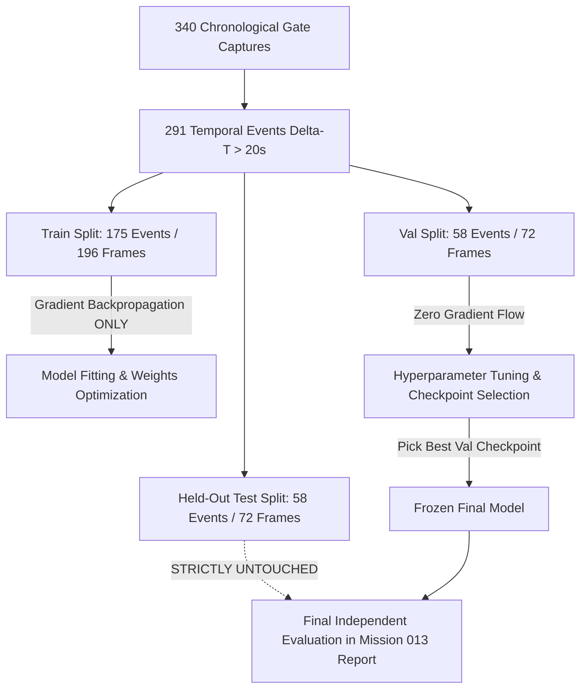

# Mission 013 Training-Readiness Report & Protocol

**Milestone:** Mission 012B Technical Preparation  
**Target:** Exploratory Domain Fine-Tuning on Egyptian Gate Footage  
**Status:** Protocol Frozen & Ready for Execution  

---

## 1. Executive Justification & Scientific Scope

The empirical benchmarks established in Mission 012 and 012B prove that **off-the-shelf COCO-pretrained vehicle detectors exhibit critical failure modes on the target gate domain**:
1. **YOLOv8n / YOLOv8m (CNNs):** Suffer near-total failure in darkness (0.0% recall in deep night IR, 4.0% recall in evening IR on the test split) due to missing wheel priors, retro-reflective plate photometric clamping, and dark cab underexposure.
2. **RT-DETR-L (Vision Transformer):** Successfully attends to dark vehicle bodies in night IR (achieving 75.0% recall on the test split), but off-the-shelf COCO weights generate unacceptable false alarms on facility barriers and glare (**1.15 false positives per image**, resulting in a low test precision of **39.42%**), while consuming 67.2 ms latency.

**Domain-specific fine-tuning on our annotated dataset is scientifically and operationally justified.** However, because the current dataset contains 196 training frames and only 6 deep-night training frames, Mission 013 is strictly classified as an **exploratory domain adaptation experiment**, NOT a production release.

---

## 2. Candidate Architecture Comparison for Domain Training

| Architectural Criterion | RT-DETR Fine-Tuning (`rtdetr-l` or `rtdetr-r18vd`) | Permissive YOLO Fine-Tuning (`yolov10n` / `yolov10s`) | Ultralytics YOLOv8 Fine-Tuning (`yolov8s` / `yolov8m`) |
| :--- | :--- | :--- | :--- |
| **Upstream Authors** | Baidu PaddleDetection | Tsinghua University (THU-MIG) | Ultralytics Inc. |
| **Code & Weight License** | **Apache-2.0** (Permissive) | **Apache-2.0** (Permissive) | **AGPL-3.0** (Copyleft Network Trigger) |
| **Commercial SaaS Feasibility** | **HIGH** (Safe if decoupled from Ultralytics wrapper) | **HIGH** (Permissive, clean open source) | **LOW** (Requires commercial enterprise license) |
| **Night IR Feature Extraction** | **EXCELLENT:** Multi-scale deformable self-attention cross-correlates distant patches without wheels | **UNKNOWN ON GATE IR:** Needs empirical validation of NMS-free dual assignments on dark silhouettes | **POOR IN NIGHT IR:** Pure localized CNN edge filters struggle on featureless dark cabs |
| **Inference Latency Target** | Moderate (35 – 55 ms PyTorch; 15 – 25 ms TensorRT) | Fast (12 – 20 ms PyTorch; 6 – 10 ms TensorRT) | Fast (15 – 25 ms PyTorch; 8 – 12 ms TensorRT) |
| **VRAM Consumption (Train)** | High (~6.5 – 7.8 GB on batch size 4) | Low-to-Moderate (~3.5 – 5.0 GB on batch size 8) | Moderate (~4.0 – 5.5 GB on batch size 8) |
| **Recommended Staging** | **Candidate 1 (Primary for Night IR):** Directly tests if fine-tuning suppresses false alarms while retaining night recall | **Candidate 2 (Secondary for Latency):** Tests if permissive dual-label assignment improves day/evening throughput | **Benchmark Control Baseline:** Retained strictly for comparative audit against historical baselines |

---

## 3. Strict Anti-Leakage Training Protocol

To guarantee scientific reproducibility and prevent data leakage:

1. **Partition Isolation:**
   - **Training Set (196 frames):** Strictly the ONLY data used for backpropagation, weight updates, and loss computation.
   - **Validation Set (72 frames):** Used exclusively for early stopping, learning rate scheduling, confidence threshold selection, and model comparison.
   - **Held-Out Test Set (72 frames):** **Completely frozen and untouched**. Evaluated exactly once at the end of Mission 013 to report final unbiased generalization metrics.
2. **Deterministic Reproducibility:**
   - Random Seed: Fixed globally (`seed=42` in PyTorch, NumPy, and CUDA).
   - Deterministic CuDNN flags: `torch.backends.cudnn.deterministic = True`.
   - Environment and library versions logged before training starts.
3. **Hardware & VRAM Budgeting:**
   - Active GPU: NVIDIA GeForce RTX 4060 Laptop GPU (8187 MiB VRAM).
   - Precision: Mixed Precision FP16 (`half=True`) to maintain VRAM overhead below 7.0 GB and avoid out-of-memory (OOM) crashes.
   - Batch Size: 4 (RT-DETR) or 8 (YOLO), input resolution 640x640.

---

## 4. Realistic Performance Targets vs. Disclaimers

### Prohibited Claims
In accordance with system engineering principles:
- **We do NOT claim that exploratory training on 196 frames will automatically achieve 90% precision or 15 ms latency.**
- A training set of 196 frames (including only 6 deep-night frames) is small. Overfitting to specific truck grilles or lighting artifacts is a significant risk.

### Measurable Hypotheses to Test in Mission 013
1. **Hypothesis 1 (False Positive Reduction in RT-DETR):** Fine-tuning RT-DETR on gate footage will penalize background barrier structure proposals, raising test set precision from 39.42% toward 60%–75%.
2. **Hypothesis 2 (Night Detection Retention):** RT-DETR will retain its deep-night detection capability ($>80\%$ yield) on held-out night frames.
3. **Hypothesis 3 (IoU Boundary Alignment):** Fine-tuning will teach the network to predict bounding boxes matching the steep 45° overhead camera perspective (bounding the cab roof and windshield), improving mAP@0.50:0.95 from 0.1179 toward $>0.25$.

---

## 5. Prerequisite Dataset Conversion for Mission 013

Before launching training in Mission 013, the following automated data format conversion must occur:
- Ground truth bounding boxes `[x1, y1, x2, y2]` in `vehicle_ground_truth.json` must be converted to normalized YOLO format `[class_id, x_center, y_center, width, height]` (0.0 to 1.0) under `artifacts/missions/mission_013/dataset/`.
- `data.yaml` must be generated defining training and validation paths and class names.
- Checkpoint hashes and validation logs must be saved deterministically.
