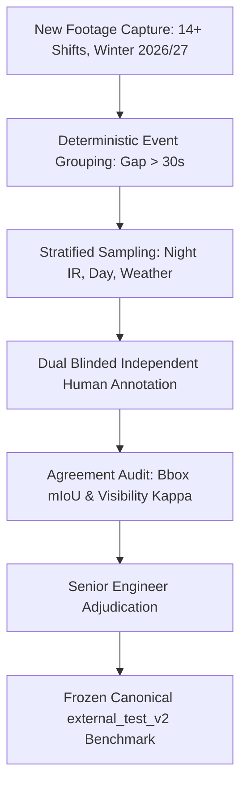

# PROTOCOL: External Benchmark Test Set (`external_test_v2`)

**Project:** Egyptian Vehicle Intelligence & Barrier-Gate ALPR System  
**Document ID:** `ETP-002`  
**Milestone:** Mission 012C / Mission 013 Pre-Requisite  
**Author:** Senior Computer Vision Engineer  
**Status:** Approved & Frozen Protocol  

---

## 1. Status Freeze of `development_test_v1`

### 1.1 Methodology Justification
In computer vision and applied machine learning, once a held-out test split has been evaluated repeatedly across multiple architecture candidates (Missions 012 and 012B) and used to make architectural decisions (e.g., selecting RT-DETR-L over YOLOv8n due to nighttime IR recall), **that test set has leaked into the model selection loop**.

Continuing to report improvements on this 72-frame split as "unbiased generalization performance" would violate scientific integrity. Therefore, effective immediately:
- The 72-frame test partition defined in `artifacts/missions/mission_012/benchmark_splits.json` is formally designated as **`development_test_v1`**.
- `development_test_v1` is reserved strictly as an **internal development validation split** for Mission 013 domain-adaptation experiments.
- **Explicit Prohibition:** Under no circumstances will performance gains on `development_test_v1` during Mission 013 be claimed as "fresh held-out generalization evidence." Any such gains are explicitly labeled as *development-set progress*.

---

## 2. Specification for Future External Benchmark (`external_test_v2`)

To validate production readiness for commercial barrier-gate deployments, an external benchmark dataset (**`external_test_v2`**) must be collected, curated, annotated, and audited according to the following protocol:

### 2.1 Collection Scope & Temporal Independence
1. **Temporal Disconnection:** Footage must be recorded from a distinct calendar month or operational season (minimum 30 days after the October 2026 historical capture window) to prevent seasonal, lighting, or camera-pose correlation.
2. **Sample Volume:** Minimum **500 independently sampled frames** comprising at least **250 distinct transit events**.
3. **Nocturnal Target:** Minimum **200 deep-night IR frames** recorded across at least 14 distinct shifts between 22:00 and 05:30 (overcoming the $n=2$ sample scarcity of `development_test_v1`).

### 2.2 Vehicle & Operational Diversity
The dataset must enforce minimum instance quotas across the operational vehicle fleet:
- **Heavy Commercial Vehicles ($\ge 60\%$):** Flatbed semi-trailers, petroleum/water tankers, enclosed dry-van box trucks, tipper dump trucks, concrete mixers, and container chassis.
- **Light Commercial & Utility ($\ge 20\%$):** Pickup trucks (single/double cab), delivery vans, microbuses.
- **Passenger Vehicles ($\ge 10\%$):** Sedans, SUVs, station wagons.
- **Atypical & Non-Standard ($\ge 10\%$):** Buses, three-wheeled cargo tricycles (tok-tok/taras), construction equipment, and tractors.

### 2.3 Environmental & Degraded Illumination Regimes
Sampling must deliberately capture real-world ingress conditions:
- **Severe Glare:** Direct high-beam and auxiliary LED work-light illumination into the camera sensor.
- **Adverse Weather:** Heavy night fog, industrial dust/sand haze (frequent in Egyptian desert-bordering logistics depots), and rain pavement specularities.
- **Extreme Perspective Ingress:** Vehicles entering at sharp diagonal angles ($> 30^\circ$ off lane centerline) or stopped off-center under the boom barrier.

---

## 3. Independent Human Annotation & Quality Protocol

### 3.1 Blinded Dual-Annotator Protocol
1. Two independent human annotators will label each frame separately.
2. Annotators will have **zero access to model predictions**, historical labels, or each other's work.
3. Full original resolution ($3840 \times 2160$) must be used for labeling.

### 3.2 Mathematically Rigorous Agreement Metrics
To evaluate inter-annotator consistency prior to adjudication, separate metrics must be computed for each annotation dimension:

1. **Bounding Box Spatial Agreement (Continuous Coordinate Geometry):**
   - Cohen's Kappa is **mathematically invalid** for continuous coordinate geometry and must NOT be used for bounding boxes.
   - Spatial agreement between Annotator A and Annotator B will be measured using:
     $$\text{mIoU} = \frac{1}{N} \sum_{i=1}^N \frac{\text{Area}(B_A \cap B_B)}{\text{Area}(B_A \cup B_B)}$$
     *(Acceptance threshold: $\text{mIoU} \ge 0.88$ on matched vehicle cabs).*
     - Bounding box centroid Euclidean distance (threshold: $\le 15$ pixels in $4\text{K}$).
     - Average Precision ($\text{AP}_{0.50}, \text{AP}_{0.75}$) using Annotator A as reference.

2. **Vehicle Class Agreement (Multiclass Categorical):**
   - Multiclass Confusion Matrix.
   - Overall Class Agreement Accuracy and Class Macro F1-score:
     $$\text{Accuracy}_{\text{class}} \ge 95.0\%$$

3. **Visibility & Truncation Attributes (Discrete Categorical):**
   - For categorical attributes (`fully_visible`, `partially_visible`, `heavily_occluded`, `truncated_by_frame`), **Cohen's Kappa ($\kappa$)** is mathematically appropriate and will be reported:
     $$\kappa = \frac{P_o - P_e}{1 - P_e} \ge 0.80 \quad (\text{Substantial to Near-Perfect Agreement})$$

### 3.3 Adjudication & Ground Truth Freeze
- Any bounding box with $\text{IoU} < 0.80$, class discrepancy, or adjudication flag will be reviewed by the Lead Computer Vision Engineer.
- Final reconciled boxes will be serialized to `artifacts/benchmarks/external_test_v2/ground_truth.json` with immutable cryptographic SHA-256 digest.

---

## 4. Benchmark Preservation Rules
- `external_test_v2` will remain **strictly read-only and frozen**.
- Models being fine-tuned or trained will NEVER have access to `external_test_v2` during training, validation, or hyperparameter selection.
- Only final frozen checkpoints produced at the conclusion of Mission 013 (or subsequent missions) will be evaluated on `external_test_v2` for formal production sign-off.
