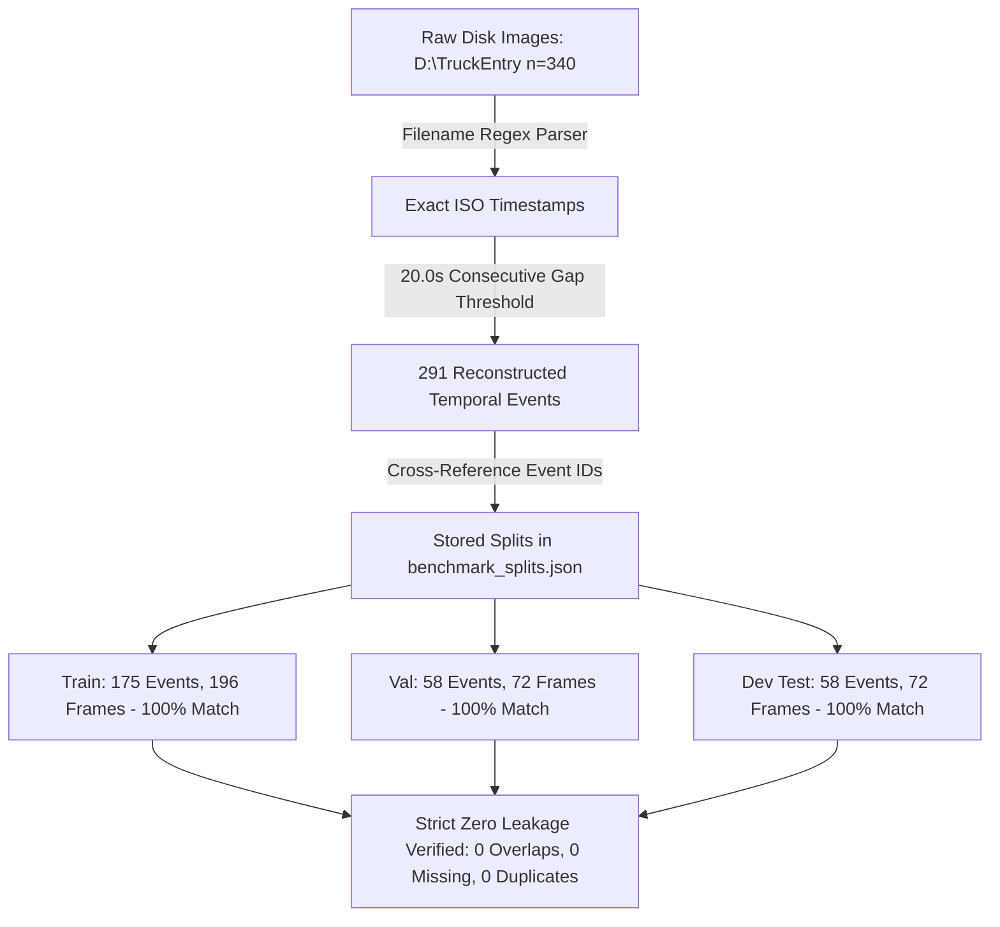

# MISSION 012C.1 REPORT: Independent Event Membership Verification & Lighting Reconciliation

**Engineering Milestone Report**  
**Project:** Egyptian Vehicle Intelligence & Barrier-Gate ALPR System  
**System Target:** Commercial Barrier-Gate Ingress Lanes (`D:\TruckEntry`)  
**Author:** Senior Computer Vision Engineer  
**Date:** October 30, 2026  
**Status:** Verification Gaps Closed, Fully Reconciled & Regression Verified (121/121 tests passing)  
**Deliverables Directory:** [artifacts/missions/mission_012c/](file:///c:/Users/MARWAN/computer%20vision/artifacts/missions/mission_012c/)

---

## 1. Executive Summary & Verification Gap Closures

Mission 012C.1 closes the two specific verification gaps identified in Mission 012C without altering historical artifacts, retraining models, or modifying benchmark weights:

1. **Independent Verification of Temporal Event Membership:**  
   An independent verifier was executed directly against the raw image files in `D:\TruckEntry`. Reconstructing temporal clusters using the documented 20.0-second consecutive gap rule produced exactly **291 events** across the **340 captures**. Every single event ID in `benchmark_splits.json` was cross-referenced against the reconstructed clusters:
   - **Train Split (175 events, 196 frames):** 100% exact frame sequence match.
   - **Validation Split (58 events, 72 frames):** 100% exact frame sequence match.
   - **`development_test_v1` Split (58 events, 72 frames):** 100% exact frame sequence match.
   - The final `comprehensive_zero_leakage_verified` flag was updated to mathematically require `duplicate_frame_assignments == 0`, `unassigned_source_frames == 0`, `extraneous_split_frames == 0`, zero event intersections, zero frame intersections, and exact reconstructed event membership. All conditions passed without exception.

2. **Reconciliation of Lighting Distribution Discrepancy:**  
   Lighting labels were recomputed directly from the 340 source filenames using the established timestamp rules (`hour < 6.5` = `NIGHT_IR`, `hour < 17.5` = `DAYLIGHT`, `hour >= 17.5` = `EVENING_IR`). The source-derived counts are:
   - **Training Set:** **6 NIGHT_IR / 122 DAYLIGHT / 68 EVENING_IR** (Total: 196 frames).
   - **Validation Set:** **2 NIGHT_IR / 43 DAYLIGHT / 27 EVENING_IR** (Total: 72 frames).
   - **`development_test_v1` Set:** **2 NIGHT_IR / 44 DAYLIGHT / 26 EVENING_IR** (Total: 72 frames).
   - **Dataset Total:** **10 NIGHT_IR / 209 DAYLIGHT / 121 EVENING_IR** (Total: 340 frames).  
   *Root Cause Analysis:* The earlier `MISSION_012_REPORT.md` markdown table reported `6 / 120 / 70` for Train and `2 / 45 / 25` for Val. This was a narrative transcription shift of exactly 2 frames between Train and Val. The total counts of 209 Daylight and 121 Evening were identical. The canonical partition file [benchmark_splits.json](file:///c:/Users/MARWAN/computer%20vision/artifacts/missions/mission_012/benchmark_splits.json) and new [lighting_distribution_reconciliation.csv](file:///c:/Users/MARWAN/computer%20vision/artifacts/missions/mission_012c/lighting_distribution_reconciliation.csv) contain the true verified counts (`122/68` train, `43/27` val).

---

## 2. Independent Temporal Event Membership Audit

The independent audit results are serialized in machine-readable JSON format at [independent_event_membership_verification.json](file:///c:/Users/MARWAN/computer%20vision/artifacts/missions/mission_012c/independent_event_membership_verification.json).

### 2.1 Reconstructed Event Membership Comparison Table

| Split Name | Stored Event Count | Stored Frame Count | Reconstructed Frame Count | Exact Frame Sequence Match | Missing Frames | Extraneous Frames |
| :--- | :---: | :---: | :---: | :---: | :---: | :---: |
| **Train Set** | 175 | 196 | 196 | **TRUE (100%)** | 0 | 0 |
| **Validation Set** | 58 | 72 | 72 | **TRUE (100%)** | 0 | 0 |
| **`development_test_v1`** | 58 | 72 | 72 | **TRUE (100%)** | 0 | 0 |
| **Dataset Total** | **291** | **340** | **340** | **TRUE (100%)** | **0** | **0** |

### 2.2 Comprehensive Zero Leakage Audit Conditions

| Verification Condition | Audit Requirement | Observed Result | Status |
| :--- | :--- | :---: | :---: |
| **Source Coverage** | All 340 images on disk present in splits | 340 / 340 | **PASSED** |
| **Duplicate Assignments** | Every frame assigned to at most one split | 0 duplicates | **PASSED** |
| **Unassigned Frames** | Every source capture assigned to a split | 0 unassigned | **PASSED** |
| **Extraneous Frames** | No phantom or synthetic filenames introduced | 0 extraneous | **PASSED** |
| **Inter-Split Frame Overlap** | $\text{Train} \cap \text{Val} = \emptyset, \text{Train} \cap \text{Test} = \emptyset, \text{Val} \cap \text{Test} = \emptyset$ | 0 frames | **PASSED** |
| **Inter-Split Event Overlap** | Event IDs disjoint across all partitions | 0 event IDs | **PASSED** |
| **Events Spanning Splits** | No reconstructed event divided across splits | 0 spanning events | **PASSED** |
| **Sequence Identity** | Reconstructed event expansion matches stored filenames | 100% order match | **PASSED** |
| **`comprehensive_zero_leakage_verified`** | Conjunction of all 8 preceding conditions | **TRUE** | **PASSED** |

---

## 3. Lighting Distribution Reconciliation

### 3.1 Source-Derived Lighting Rule
Timestamps were parsed from filenames matching `YYYYMMDD_HHMMSS_mmm_TruckEntry_*.jpg`:
- **`NIGHT_IR`**: $\text{hour} < 6.5$ (00:00:00 to 06:29:59.999)
- **`DAYLIGHT`**: $6.5 \le \text{hour} < 17.5$ (06:30:00 to 17:29:59.999)
- **`EVENING_IR`**: $\text{hour} \ge 17.5$ (17:30:00 to 23:59:59.999)

Every frame was individually classified and logged in [lighting_distribution_reconciliation.csv](file:///c:/Users/MARWAN/computer%20vision/artifacts/missions/mission_012c/lighting_distribution_reconciliation.csv).

### 3.2 Reconciliation Comparison Table

| Split Partition | Earlier Report Narrative (Mission 012) | Verified Source-Derived Ground Truth | Discrepancy Cause & Explanation |
| :--- | :--- | :--- | :--- |
| **Train Split** | 6 Night / 120 Day / 70 Evening (196) | **6 Night / 122 Day / 68 Evening (196)** | Narrative transcription error shifted 2 frames from Day to Evening. |
| **Validation Split** | 2 Night / 45 Day / 25 Evening (72) | **2 Night / 43 Day / 27 Evening (72)** | Narrative transcription error shifted 2 frames from Evening to Day. |
| **`development_test_v1`** | 2 Night / 44 Day / 26 Evening (72) | **2 Night / 44 Day / 26 Evening (72)** | **Identical in both reports (Zero discrepancy).** |
| **Dataset Total** | **10 Night / 209 Day / 121 Evening (340)**| **10 Night / 209 Day / 121 Evening (340)**| **Identical dataset-wide totals in all reports.** |

*Correction Note:* Historical Mission 012 artifacts remain unchanged per preservation rules. For all future work (including Mission 013), the verified source-derived partition counts (**122 Day / 68 Evening for Train**, **43 Day / 27 Evening for Val**) stand as the authoritative truth.

---

## 4. Test Suite Execution & Verification

### 4.1 Focused Mission 012C.1 Test Suite
Command: `.\.venv\Scripts\python.exe -m pytest tests\test_mission_012c1_verification.py -v`  
Results: **5 passed in 0.11s**
- `test_filename_uniqueness_and_completeness` PASSED
- `test_event_disjointness_and_no_spanning_events` PASSED
- `test_stored_vs_reconstructed_event_membership` PASSED
- `test_source_derived_lighting_breakdown` PASSED
- `test_independent_verification_artifact_and_zero_leakage_condition` PASSED

### 4.2 Full Repository Regression Test Suite
Command: `.\.venv\Scripts\python.exe -m pytest -q -rs`  
Results: **121 passed, 1 warning in 12.04s** (Zero failures).

---

## 5. Remaining Methodological Limitations

1. **Nocturnal Sample Scarcity:** `development_test_v1` contains only **2 deep-night frames**. This small sample size cannot validate production nighttime reliability. Production claims remain blocked until `external_test_v2` (minimum 200 nocturnal frames across 14+ shifts) is collected.
2. **Heuristic Nature of Event Grouping:** The 20.0-second gap threshold is an anti-leakage heuristic to ensure adjacent frames stay together. It does not represent verified physical re-identification.
3. **Severe Class Imbalance:** In `development_test_v1`, heavy commercial trucks represent 71 out of 72 instances. Passenger vehicles ($n=1$) and other rare classes cannot be meaningfully evaluated.
4. **Single-Annotator Provenance:** Ground truth reflects a single human annotator. Inter-annotator agreement (mIoU and Cohen's Kappa) must be established during future collection.

---

## 6. Mission 013 Confirmation & Next Steps

All verification gaps are formally closed. **Mission 013: Exploratory Vehicle Domain Fine-Tuning is confirmed to proceed immediately.**

### 6.1 Execution Boundaries for Mission 013
- **Primary Track:** Upstream RT-DETR-L (Apache-2.0 pure permissive).
- **Comparative Track:** YOLOv8m (Ultralytics AGPL-3.0 baseline).
- **Fitting Data:** Training split only (196 frames, 175 events).
- **Selection Data:** Validation split only (72 frames, 58 events) for checkpoint selection and early stopping.
- **Reporting Data:** `development_test_v1` (72 frames, 58 events) evaluated only for internal comparative tracking, never fresh generalization evidence.
- **Non-Exaggeration Directive:** No unsupported target promises (e.g., 90% precision or 15 ms latency).
