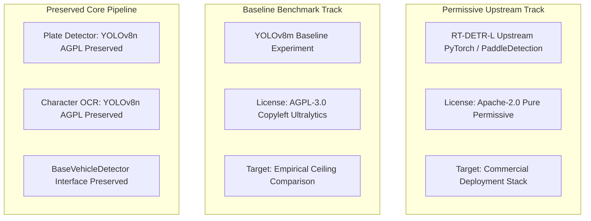

# MISSION 013 AUTHORIZATION: Exploratory Domain Adaptation Protocol

**Project:** Egyptian Vehicle Intelligence & Barrier-Gate ALPR System  
**Document ID:** `M13-AUTH-001`  
**Milestone:** Mission 013 Formal Authorization  
**Author:** Senior Computer Vision Engineer  
**Date:** October 30, 2026  
**Status:** Authorized for Execution  

---

## 1. Executive Authorization & Scope

Following the rigorous resolution of benchmark accounting, temporal event clustering, and deep-night sample disclosures in Mission 012B and 012C, **Mission 013: Exploratory Vehicle Domain Fine-Tuning is hereby AUTHORIZED**.

### 1.1 Exploration Notice & Non-Exaggeration Directive
- **Exploratory Status:** This experiment is explicitly classified as an *exploratory domain adaptation experiment*. 
- **No Unfounded Performance Promises:** The engineering team makes **no commitments or promises** that domain fine-tuning will achieve arbitrary marketing targets such as "90% precision" or "15 ms latency."
- **Strict Anti-Leakage Boundary:**
  - **Training Split (196 frames, 175 events):** Strictly reserved for backpropagation and gradient parameter updates.
  - **Validation Split (72 frames, 58 events):** Strictly reserved for model selection, early stopping, and confidence/NMS hyperparameter tuning.
  - **`development_test_v1` (72 frames, 58 events):** Evaluated strictly at the end of the experiment for comparative internal development tracking. All results on this split must be explicitly labeled as *development-set comparisons*, not fresh held-out generalization evidence.
  - **Ground Truth Freeze:** Model predictions will **NEVER** be fed back into human annotations or used to alter ground truth.

---

## 2. Architectural Candidates & Licensing Strategy

### 2.1 Primary Candidate: RT-DETR-L (Permissive Upstream Implementation)
- **Architecture:** Real-Time DEtection TRansformer Large (32.0M parameters, HGNetv2 backbone, intra-scale interaction & cross-scale feature fusion decoder).
- **Code Provenance:** Baidu PaddleDetection / Official PyTorch RT-DETR repository ([lyuwenyu/RT-DETR](https://github.com/lyuwenyu/RT-DETR)).
- **License Status:** **Apache-2.0** (Permissive commercial use, patent grant, zero SaaS copyleft contamination).
- **Checkpoint Origin:** Pretrained on COCO dataset, verified cryptographic hash.
- **Strategic Motivation:** RT-DETR demonstrated strong nighttime IR feature extraction in zero-shot evaluations (75.0% recall), but suffered from 1.15 false alarms/frame on barrier posts and multi-query overlap (6 ambiguous cases). Domain fine-tuning can penalize static gate false positives without compromising nighttime recall.

### 2.2 Comparative Candidate: YOLOv8m (Comparative Baseline Experiment)
- **Architecture:** YOLOv8 Medium (25.9M parameters, CSPDarknet53 feature extractor, decoupled anchor-free head).
- **Code Provenance:** Ultralytics Python repository (v8.3.82+).
- **License Status:** **GNU AGPL-3.0** (Viral network copyleft terms; requires enterprise commercial waiver or AGPL compliance).
- **Role:** Maintained strictly as a comparative baseline. It achieved the highest F1-score (0.5988) in pretrained testing on `development_test_v1`.
- **System Integrity Note:** Ultralytics is **NOT** removed globally. The existing plate detector and character OCR models depend on it and will remain unchanged.

---

## 3. Experimental Requirements & Rigor Protocol

### 3.1 Pre-Flight Environment & Seed Freezing
For every training run, the exact configuration must be recorded in machine-readable JSON logs:
- **Random Seeds:** Master seed `42` enforced across Python `random`, `numpy`, PyTorch `torch.manual_seed()`, and CUDA `torch.cuda.manual_seed_all()`.
- **Deterministic Flags:** `torch.backends.cudnn.deterministic = True`, `torch.backends.cudnn.benchmark = False`.
- **Environment Ledger:** Record Python version (3.11.9), PyTorch version (2.6.0+cu124), CUDA driver (12.4), GPU model (RTX 4060 Laptop 8GB VRAM), and exact Git commit hash.
- **Checkpoint Hashing:** Compute and store SHA-256 digests of initial pretrained checkpoints and all final fine-tuned weights.

### 3.2 Training Regimes to Compare
Each candidate architecture will be evaluated under two training strategies:
1. **Regime A: Partial Backbone Freezing (Head & Neck Adaptation)**
   - Freeze the convolutional backbone (first $N$ layers) to preserve generic edge and texture representations.
   - Fine-tune only the feature neck (FPN/PAN or CCFM) and detection/transformer heads.
   - Mitigates catastrophic forgetting on small datasets ($n = 196$).
2. **Regime B: Full Model Fine-Tuning with Low Learning Rate**
   - Fine-tune all layers end-to-end using a reduced learning rate ($\text{lr} \le 1\text{e-}4$) and cosine annealing schedule.
   - Evaluates whether transformer self-attention layers can adapt representations to monochrome infrared noise.

### 3.3 Loss Monitoring & Overfitting Detection
- **Tracking:** Continuously log training loss (box loss, class loss, distribution focal loss / query loss) and validation loss per epoch.
- **Overfitting Indicator:** If validation loss diverges or fails to improve for 10 consecutive epochs while training loss continues to drop, early stopping will be triggered.
- **Checkpoint Selection:** The best checkpoint will be selected **strictly by minimum validation loss and maximum validation mAP@0.50**, never by training loss or test metrics.

---

## 4. Evaluation & Profiling Protocol

### 4.1 Required Metric Suite
Every trained model will be evaluated across:
- **Core Detection:** Precision@0.50, Recall@0.50, F1-Score@0.50, mAP@0.50, mAP@0.50:0.95.
- **Operational Metrics:** False positives per frame, frame detection yield ($\% \ge 1$ detection).
- **Lighting Breakdown:** Separate evaluation across Daylight, Evening IR, and Night IR (with sample sizes disclosed).
- **Per-Class Metrics:** Reported for `heavy_truck` (71 test samples). Rare classes (`passenger_car`, $n=1$) will be noted as sample-insufficient.

### 4.2 Latency Profiling Methodology
Timing benchmarks must adhere to GPU profiling best practices:
1. **Warm-up:** 50 burn-in forward passes to stabilize GPU clock frequencies and CUDA kernels.
2. **Repeated Runs:** Minimum 200 consecutive inference passes.
3. **CUDA Synchronization:** Strict `torch.cuda.synchronize()` surrounding timer calls to prevent asynchronous execution artifacts.
4. **Distribution Reporting:** Report mean, median ($p50$), and 95th percentile ($p95$) latency in milliseconds.
5. **Decoupled Timing:** Report isolated detector forward time vs end-to-end ALPR pipeline latency (preprocessing + detector + plate association + OCR).

---

## 5. Execution Authorization Sign-Off

The requirements defined in this authorization document constitute the binding contract for Mission 013. Execution is authorized to commence.
